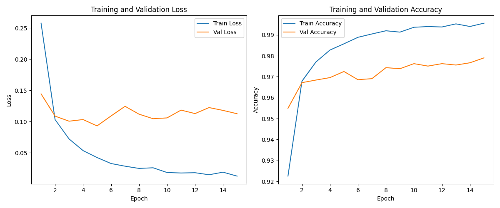
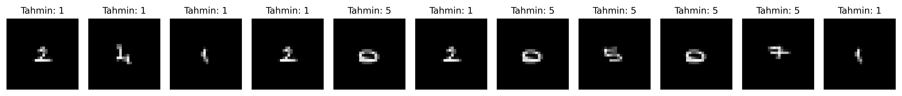

# MNIST Veri Seti ile MLP Tabanlı El Yazısı Rakam Tanıma

Bu çalışmada MNIST el yazısı rakam veri seti kullanılarak Evrişimli Sinir Ağları (CNN) kullanılmaksızın, Çok Katmanlı Algılayıcı (MLP) mimarisiyle bir sınıflandırma modeli geliştirilmiştir. Modelin başarımı hem test veri seti hem de el yazısıyla yazılmış öğrenci numarası rakamları üzerinde değerlendirilmiştir.

## 1. Model Mimarisi ve Hiperparametreler
- **Model:** Multi-Layer Perceptron (MLP)
- **Giriş Katmanı:** 784 nöron (28x28 piksel düzleştirilmiş giriş)
- **Gizli Katman 1:** 256 nöron (ReLU aktivasyonu)
- **Gizli Katman 2:** 128 nöron (ReLU aktivasyonu)
- **Çıkış Katmanı:** 10 nöron (0-9 sınıfları)
- **Kayıp Fonksiyonu:** CrossEntropyLoss
- **Optimizasyon:** Adam (lr=0.001)
- **Batch Size:** 64
- **Epoch:** 15
- **Veri Dağılımı:** %80 Eğitim, %20 Doğrulama (Validation), ayrı Test kümesi

## 2. Eğitim Grafikleri

Grafiklerde eğitim ve doğrulama kayıplarının istikrarlı şekilde azaldığı, aşırı öğrenme (overfitting) oluşmadan modelin yakınsadığı görülmektedir.

## 3. Kendi El Yazısı ile Test ve Değerlendirme
Kendi el yazımla kağıda yazdığım öğrenci numarasının rakamları fotoğraflanmış, eşikleme ve boyutlandırma adımlarıyla $28 \times 28$ gri seviyeli formata getirilerek modele verilmiştir.

### Dağılım Kayması (Distribution Shift) ve Model Kısıtları Analizi
Model MNIST test kümesinde yüksek doğruluk elde etmesine karşın, kendi el yazım üzerinde test edildiğinde bazı rakamlarda yanlış tahminler yapmıştır. Bunun temel nedenleri:

1. **MLP Modelinin Konumsal Duyarlılığı (Spatial Invariance Eksikliği):** 
   MLP modelleri 2 boyutlu görüntü matrisini tek boyutlu 784 elemanlı bir vektöre dönüştürerek işler. CNN'lerdeki gibi piksellerin birbirine göre konumunu ve kenar/köşe filtrelerini koruyamaz. Rakam görselin merkezinden birkaç piksel saptığında model pikselleri doğru eşleştiremez.

2. **Veri Dağılımı Farklılığı (Distribution Shift):** 
   MNIST veri setindeki rakamların çizgi kalınlığı, vuruş açıları ve kenar yumuşatmaları (antialiasing) belirli bir standarttadır. Gerçek hayatta kağıt üzerine tükenmez kalemle yazılan çizgiler ile eğitim setinin dağılımı tam örtüşmediği için model genelleme yapmakta zorlanmıştır.
